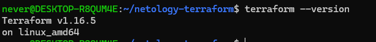
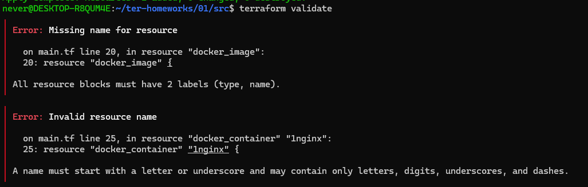
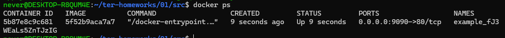
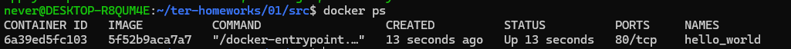

### Чек-лист


### Задание 1

- Пункт 2: Изучите файл .gitignore. В каком terraform-файле, согласно этому .gitignore, допустимо сохранить личную, секретную информацию?(логины,пароли,ключи,токены итд)
- Ответ: в personal.auto.tfvars
-----
- Пункт 3: Выполните код проекта. Найдите в state-файле секретное содержимое созданного ресурса random_password, пришлите в качестве ответа конкретный ключ и его значение.
- Ответ: "result": "fJ3WEaLs5ZnTJzIG"


--------
- Пункт 4: Раскомментируйте блок кода, примерно расположенный на строчках 29–42 файла main.tf. Выполните команду terraform validate. Объясните, в чём заключаются намеренно допущенные ошибки. Исправьте их.
- Ошибки:
- У docker_image отсутствовало имя ресурса
- У docker_container неверный нейминг ресурса (1nginx)
- resulT вместо result
- random_string_FAKE вместо random_string
----
- Пункт 5
- 


```commandline
terraform {
  required_providers {
    docker = {
      source  = "kreuzwerker/docker"
    }
  }
  required_version = "~>1.16.0"
}
provider "docker" {}


resource "random_password" "random_string" {
  length      = 16
  special     = false
  min_upper   = 1
  min_lower   = 1
  min_numeric = 1
}

resource "docker_image" "nginx" {
  name         = "nginx:latest"
  keep_locally = true
}

resource "docker_container" "nginx" {
  image = docker_image.nginx.image_id
  name  = "example_${random_password.random_string.result}"

  ports {
    internal = 80
    external = 9090
  }
}
```
----------
- Пункт 6.

- --auto-approve опасен тем что terraform не запрашивает подтверждение перед применением изменений инфры.
Он не покажет изменения которые будут применяться 
------
- Пункт 7

```commandline
{
  "version": 4,
  "terraform_version": "1.16.5",
  "serial": 16,
  "lineage": "6b96ed3c-b434-6622-6482-fa3dc6c8b6c6",
  "outputs": {},
  "resources": [],
  "check_results": null
}
```

----
- Пункт 8
- Образ не удалился из за параметра keep_locally = true
- Строчка из документации: keep_locally (Boolean) If true, then the Docker image won't be deleted on destroy operation. If this is false, it will delete the image from the docker local storage on destroy operation.


