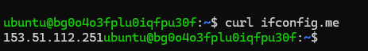
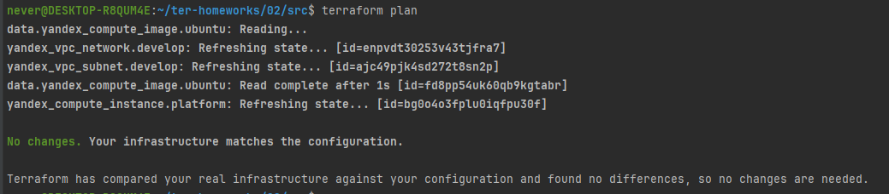
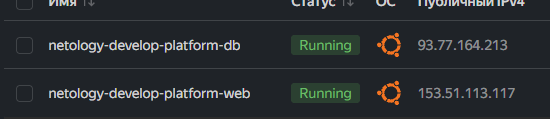
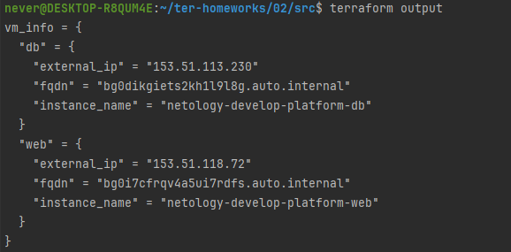
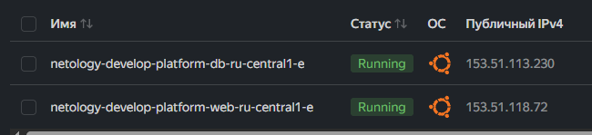
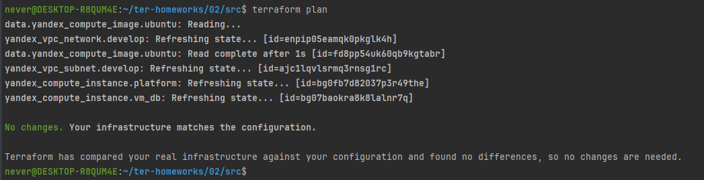

###  Задание 1

- Пункт 4. 
- Ошибки были вида: отсутствие default у cloud_id и folder_id. Наименование переменной vms_ssh_root_key вместо vms_ssh_public_root_key. Указание platform_id = "standart-v4 (такого нет), standart вместо standard
- cores         = 1, минимальное значение 2

- Пункт 5.




- Пункт 6.
- preemptible = true - данный параметр нужен, чтобы наша ВМ была прерываемой, позволяет экономить деньги
- core_fraction=5 - базовый уровень производительности вм, так же экономит деньги

```commandline
resource "yandex_vpc_network" "develop" {
  name = var.vpc_name
}
resource "yandex_vpc_subnet" "develop" {
  name           = var.vpc_name
  zone           = var.default_zone
  network_id     = yandex_vpc_network.develop.id
  v4_cidr_blocks = var.default_cidr
}


data "yandex_compute_image" "ubuntu" {
  family = "ubuntu-2004-lts"
}
resource "yandex_compute_instance" "platform" {
  name        = "netology-develop-platform-web"
  platform_id = "standard-v3"
  zone = var.default_zone
  resources {
    cores         = 2
    memory        = 1
    core_fraction = 20
  }
  boot_disk {
    initialize_params {
      image_id = data.yandex_compute_image.ubuntu.image_id
    }
  }
  scheduling_policy {
    preemptible = true
  }
  network_interface {
    subnet_id = yandex_vpc_subnet.develop.id
    nat       = true
  }

  metadata = {
    serial-port-enable = 1
    ssh-keys           = "ubuntu:${var.vms_ssh_public_root_key}"
  }

}
```

```commandline
variable "cloud_id" {
  type        = string
  description = "https://cloud.yandex.ru/docs/resource-manager/operations/cloud/get-id"
  default     = "b1g418kcu2mch2h8aob1"
}

variable "folder_id" {
  type        = string
  description = "https://cloud.yandex.ru/docs/resource-manager/operations/folder/get-id"
  default     = "b1gqldc8dptctnjiu07t"
}

variable "default_zone" {
  type        = string
  default     = "ru-central1-e"
  description = "https://cloud.yandex.ru/docs/overview/concepts/geo-scope"
}
variable "default_cidr" {
  type        = list(string)
  default     = ["10.0.1.0/24"]
  description = "https://cloud.yandex.ru/docs/vpc/operations/subnet-create"
}

variable "vpc_name" {
  type        = string
  default     = "develop"
  description = "VPC network & subnet name"
}

variable "vms_ssh_public_root_key" {
  type        = string
  default     = "ssh-ed25519 AAAAC3NzaC1lZDI1NTE5AAAAIP/FoePYQnX9MWNcmBNrszCnmuJgw6jIMx+Il7QOdvku never@DESKTOP-R8QUM4E"
  description = "ssh-keygen -t ed25519"
}
```


```commandline
terraform {
  required_providers {
    yandex = {
      source = "yandex-cloud/yandex"
    }
  }
  required_version = ">1.12.0"
}

provider "yandex" {
  # token     = var.token
  cloud_id                 = var.cloud_id
  folder_id                = var.folder_id
  zone                     = var.default_zone
  service_account_key_file = file("~/authorized_key.json")
}
```

P.s Зона e была выбрана, т.к. только там были ресурсы. В зоне e нельзя указывать что то ниже standard-v3 (соответственно минимальное значение core_fraction = 20)

---

###  Задание 2



```commandline
###cloud vars


variable "cloud_id" {
  type        = string
  description = "https://cloud.yandex.ru/docs/resource-manager/operations/cloud/get-id"
  default     = "b1g418kcu2mch2h8aob1"
}

variable "folder_id" {
  type        = string
  description = "https://cloud.yandex.ru/docs/resource-manager/operations/folder/get-id"
  default     = "b1gqldc8dptctnjiu07t"
}

variable "default_zone" {
  type        = string
  default     = "ru-central1-e"
  description = "https://cloud.yandex.ru/docs/overview/concepts/geo-scope"
}
variable "default_cidr" {
  type        = list(string)
  default     = ["10.0.1.0/24"]
  description = "https://cloud.yandex.ru/docs/vpc/operations/subnet-create"
}

variable "vpc_name" {
  type        = string
  default     = "develop"
  description = "VPC network & subnet name"
}

variable "compute_image" {
  type        = string
  default     = "ubuntu-2004-lts"
  description = "family for compute_image"
}

variable "vm_web_name" {
  type        = string
  default     = "netology-develop-platform-web"
  description = "name VM"
}

variable "vm_web_platform_id" {
  type        = string
  default     = "standard-v3"
  description = "platform_id"
}

variable "vm_web_resources" {
  type        = map
  default = {
    cpu = 2
    memory = 1
    core_fraction = 20
  }
}
###ssh vars

variable "vms_ssh_public_root_key" {
  type        = string
  default     = "ssh-ed25519 AAAAC3NzaC1lZDI1NTE5AAAAIP/FoePYQnX9MWNcmBNrszCnmuJgw6jIMx+Il7QOdvku never@DESKTOP-R8QUM4E"
  description = "ssh-keygen -t ed25519"
}

```

```commandline
resource "yandex_vpc_network" "develop" {
  name = var.vpc_name
}
resource "yandex_vpc_subnet" "develop" {
  name           = var.vpc_name
  zone           = var.default_zone
  network_id     = yandex_vpc_network.develop.id
  v4_cidr_blocks = var.default_cidr
}


data "yandex_compute_image" "ubuntu" {
  family = var.compute_image
}
resource "yandex_compute_instance" "platform" {
  name        = var.vm_web_name
  platform_id = var.vm_web_platform_id
  zone        = var.default_zone
  resources {
    cores         = var.vm_web_resources.cpu
    memory        = var.vm_web_resources.memory
    core_fraction = var.vm_web_resources.core_fraction
  }
  boot_disk {
    initialize_params {
      image_id = data.yandex_compute_image.ubuntu.image_id
    }
  }
  scheduling_policy {
    preemptible = true
  }
  network_interface {
    subnet_id = yandex_vpc_subnet.develop.id
    nat       = true
  }

  metadata = {
    serial-port-enable = 1
    ssh-keys           = "ubuntu:${var.vms_ssh_public_root_key}"
  }

}


```

---
### Задание 3
```commandline

###cloud vars


variable "cloud_id" {
  type        = string
  description = "https://cloud.yandex.ru/docs/resource-manager/operations/cloud/get-id"
  default     = "b1g418kcu2mch2h8aob1"
}

variable "folder_id" {
  type        = string
  description = "https://cloud.yandex.ru/docs/resource-manager/operations/folder/get-id"
  default     = "b1gqldc8dptctnjiu07t"
}

variable "default_zone" {
  type        = string
  default     = "ru-central1-e"
  description = "https://cloud.yandex.ru/docs/overview/concepts/geo-scope"
}
variable "default_cidr" {
  type        = list(string)
  default     = ["10.0.1.0/24"]
  description = "https://cloud.yandex.ru/docs/vpc/operations/subnet-create"
}

variable "vpc_name" {
  type        = string
  default     = "develop"
  description = "VPC network & subnet name"
}

variable "compute_image" {
  type        = string
  default     = "ubuntu-2004-lts"
  description = "family for compute_image"
}

variable "vm_web_name" {
  type        = string
  default     = "netology-develop-platform-web"
  description = "name VM"
}

variable "vm_web_platform_id" {
  type        = string
  default     = "standard-v3"
  description = "platform_id"
}

variable "vm_web_resources" {
  type        = map
  default = {
    cpu = 2
    memory = 1
    core_fraction = 20
  }
}


variable "default_zone_db" {
  type        = string
  default     = "ru-central1-e"
  description = "https://cloud.yandex.ru/docs/overview/concepts/geo-scope"
}

variable "vm_db_name" {
  type        = string
  default     = "netology-develop-platform-db"
  description = "name VM"
}

variable "vm_db_platform_id" {
  type        = string
  default     = "standard-v3"
  description = "platform_id"
}

variable "vm_db_resources" {
  type        = map
  default = {
    cpu = 2
    memory = 2
    core_fraction = 20
  }
}
###ssh vars

variable "vms_ssh_public_root_key" {
  type        = string
  default     = "ssh-ed25519 AAAAC3NzaC1lZDI1NTE5AAAAIP/FoePYQnX9MWNcmBNrszCnmuJgw6jIMx+Il7QOdvku never@DESKTOP-R8QUM4E"
  description = "ssh-keygen -t ed25519"
}

```
```commandline
resource "yandex_vpc_network" "develop" {
  name = var.vpc_name
}
resource "yandex_vpc_subnet" "develop" {
  name           = var.vpc_name
  zone           = var.default_zone
  network_id     = yandex_vpc_network.develop.id
  v4_cidr_blocks = var.default_cidr
}


data "yandex_compute_image" "ubuntu" {
  family = var.compute_image
}
resource "yandex_compute_instance" "platform" {
  name        = var.vm_web_name
  platform_id = var.vm_web_platform_id
  zone        = var.default_zone
  resources {
    cores         = var.vm_web_resources.cpu
    memory        = var.vm_web_resources.memory
    core_fraction = var.vm_web_resources.core_fraction
  }
  boot_disk {
    initialize_params {
      image_id = data.yandex_compute_image.ubuntu.image_id
    }
  }
  scheduling_policy {
    preemptible = true
  }
  network_interface {
    subnet_id = yandex_vpc_subnet.develop.id
    nat       = true
  }

  metadata = {
    serial-port-enable = 1
    ssh-keys           = "ubuntu:${var.vms_ssh_public_root_key}"
  }

}


resource "yandex_compute_instance" "vm_db" {
  name        = var.vm_db_name
  platform_id = var.vm_db_platform_id
  zone        = var.default_zone_db
  resources {
    cores         = var.vm_db_resources.cpu
    memory        = var.vm_db_resources.memory
    core_fraction = var.vm_db_resources.core_fraction
  }
  boot_disk {
    initialize_params {
      image_id = data.yandex_compute_image.ubuntu.image_id
    }
  }
  scheduling_policy {
    preemptible = true
  }
  network_interface {
    subnet_id = yandex_vpc_subnet.develop.id
    nat       = true
  }

  metadata = {
    serial-port-enable = 1
    ssh-keys           = "ubuntu:${var.vms_ssh_public_root_key}"
  }

}
```



**Пункт 2 невозможно выполнить в данном случае корректно, так как зона ru-central1-b недоступна**

---

### Задание 4


```commandline

output "vm_info" {
  value = {
    web = {
      instance_name = yandex_compute_instance.platform.name
      external_ip   = yandex_compute_instance.platform.network_interface[0].nat_ip_address
      fqdn          = yandex_compute_instance.platform.fqdn
    }
    db = {
      instance_name = yandex_compute_instance.vm_db.name
      external_ip   = yandex_compute_instance.vm_db.network_interface[0].nat_ip_address
      fqdn          = yandex_compute_instance.vm_db.fqdn
    }
  }
}
```

P.s. Предыдущие виртуалки пришлось удалить, поэтому пересоздал с новыми адресами

---

### Задание 5


```commandline
locals {
  vm_web_full_name = "${var.vm_web_name}-${var.default_zone}"
  vm_db_full_name = "${var.vm_db_name}-${var.default_zone}"
}
```
---
### Задание 6

```commandline
resource "yandex_vpc_network" "develop" {
  name = var.vpc_name
}
resource "yandex_vpc_subnet" "develop" {
  name           = var.vpc_name
  zone           = var.default_zone
  network_id     = yandex_vpc_network.develop.id
  v4_cidr_blocks = var.default_cidr
}


data "yandex_compute_image" "ubuntu" {
  family = var.compute_image
}
resource "yandex_compute_instance" "platform" {
  name        = local.vm_web_full_name
  platform_id = var.vm_web_platform_id
  zone        = var.default_zone
  resources {
    cores         = var.vms_resources["web"].cores
    memory        = var.vms_resources["web"].memory
    core_fraction = var.vms_resources["web"].core_fraction
  }
  boot_disk {
    initialize_params {
      image_id = data.yandex_compute_image.ubuntu.image_id
      size         = var.vms_resources["web"].disk_size
      type         = var.vms_resources["web"].disk_type
    }
  }
  scheduling_policy {
    preemptible = true
  }
  network_interface {
    subnet_id = yandex_vpc_subnet.develop.id
    nat       = true
  }

  metadata = {
    serial-port-enable = 1
    ssh-keys           = "ubuntu:${var.vms_ssh_public_root_key}"
  }

}


resource "yandex_compute_instance" "vm_db" {
  name        = local.vm_db_full_name
  platform_id = var.vm_db_platform_id
  zone        = var.default_zone_db
  resources {
    cores         = var.vms_resources["db"].cores
    memory        = var.vms_resources["db"].memory
    core_fraction = var.vms_resources["db"].core_fraction
  }
  boot_disk {
    initialize_params {
      image_id = data.yandex_compute_image.ubuntu.image_id
      size         = var.vms_resources["db"].disk_size
      type         = var.vms_resources["db"].disk_type
    }
  }
  scheduling_policy {
    preemptible = true
  }
  network_interface {
    subnet_id = yandex_vpc_subnet.develop.id
    nat       = true
  }

  metadata = {
    serial-port-enable = 1
    ssh-keys           = "ubuntu:${var.vms_ssh_public_root_key}"
  }

}
```

```commandline
###cloud vars


variable "cloud_id" {
  type        = string
  description = "https://cloud.yandex.ru/docs/resource-manager/operations/cloud/get-id"
  default     = "b1g418kcu2mch2h8aob1"
}

variable "folder_id" {
  type        = string
  description = "https://cloud.yandex.ru/docs/resource-manager/operations/folder/get-id"
  default     = "b1gqldc8dptctnjiu07t"
}

variable "default_zone" {
  type        = string
  default     = "ru-central1-e"
  description = "https://cloud.yandex.ru/docs/overview/concepts/geo-scope"
}
variable "default_cidr" {
  type        = list(string)
  default     = ["10.0.1.0/24"]
  description = "https://cloud.yandex.ru/docs/vpc/operations/subnet-create"
}

variable "vpc_name" {
  type        = string
  default     = "develop"
  description = "VPC network & subnet name"
}

variable "compute_image" {
  type        = string
  default     = "ubuntu-2004-lts"
  description = "family for compute_image"
}

variable "vm_web_name" {
  type        = string
  default     = "netology-develop-platform-web"
  description = "name VM"
}

variable "vm_web_platform_id" {
  type        = string
  default     = "standard-v3"
  description = "platform_id"
}

variable "default_zone_db" {
  type        = string
  default     = "ru-central1-e"
  description = "https://cloud.yandex.ru/docs/overview/concepts/geo-scope"
}

variable "vm_db_name" {
  type        = string
  default     = "netology-develop-platform-db"
  description = "name VM"
}

variable "vm_db_platform_id" {
  type        = string
  default     = "standard-v3"
  description = "platform_id"
}


variable "vms_resources" {
  description = "Map of resource configurations (cores, memory, disk) for all VMs"
  type = map(object({
    cores         = number
    memory        = number
    core_fraction = number
    disk_size     = number
    disk_type     = string
  }))
  default = {
    web = {
      cores         = 2
      memory        = 1
      core_fraction = 20
      disk_size     = 10
      disk_type     = "network-hdd"
    }
    db = {
      cores         = 2
      memory        = 2
      core_fraction = 20
      disk_size     = 10
      disk_type     = "network-ssd"
    }
  }
}
###ssh vars

variable "vms_ssh_public_root_key" {
  type        = string
  default     = "ssh-ed25519 AAAAC3NzaC1lZDI1NTE5AAAAIP/FoePYQnX9MWNcmBNrszCnmuJgw6jIMx+Il7QOdvku never@DESKTOP-R8QUM4E"
  description = "ssh-keygen -t ed25519"
}

```


- Пункт 2
```commandline
resource "yandex_vpc_network" "develop" {
  name = var.vpc_name
}
resource "yandex_vpc_subnet" "develop" {
  name           = var.vpc_name
  zone           = var.default_zone
  network_id     = yandex_vpc_network.develop.id
  v4_cidr_blocks = var.default_cidr
}


data "yandex_compute_image" "ubuntu" {
  family = var.compute_image
}
resource "yandex_compute_instance" "platform" {
  name        = local.vm_web_full_name
  platform_id = var.vm_web_platform_id
  zone        = var.default_zone
  resources {
    cores         = var.vms_resources["web"].cores
    memory        = var.vms_resources["web"].memory
    core_fraction = var.vms_resources["web"].core_fraction
  }
  boot_disk {
    initialize_params {
      image_id = data.yandex_compute_image.ubuntu.image_id
      size         = var.vms_resources["web"].disk_size
      type         = var.vms_resources["web"].disk_type
    }
  }
  scheduling_policy {
    preemptible = true
  }
  network_interface {
    subnet_id = yandex_vpc_subnet.develop.id
    nat       = true
  }

  metadata = local.common_metadata

}


resource "yandex_compute_instance" "vm_db" {
  name        = local.vm_db_full_name
  platform_id = var.vm_db_platform_id
  zone        = var.default_zone_db
  resources {
    cores         = var.vms_resources["db"].cores
    memory        = var.vms_resources["db"].memory
    core_fraction = var.vms_resources["db"].core_fraction
  }
  boot_disk {
    initialize_params {
      image_id = data.yandex_compute_image.ubuntu.image_id
      size         = var.vms_resources["db"].disk_size
      type         = var.vms_resources["db"].disk_type
    }
  }
  scheduling_policy {
    preemptible = true
  }
  network_interface {
    subnet_id = yandex_vpc_subnet.develop.id
    nat       = true
  }

  metadata = local.common_metadata

}
```

```commandline
locals {
  vm_web_full_name = "${var.vm_web_name}-${var.default_zone}"
  vm_db_full_name = "${var.vm_db_name}-${var.default_zone}"
  common_metadata = {
    serial-port-enable = tostring(var.vms_metadata["common"].serial_port_enable)
    ssh-keys           = "${var.vms_metadata["common"].ssh_user}:${var.vms_ssh_public_root_key}"
  }
}
```
