# Домашнее задание «Продвинутые методы работы с Terraform»

---

# Задание 1
Код: [lesson4/task1](lesson4/task1)

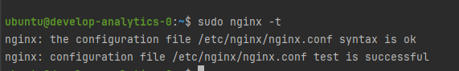
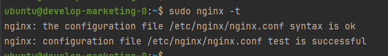

- Содержимое модуля:
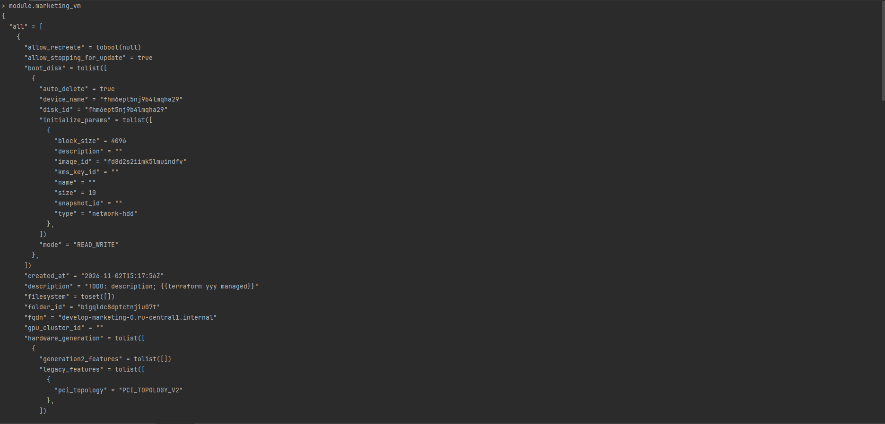
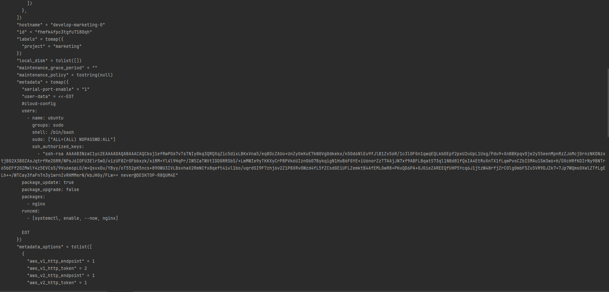
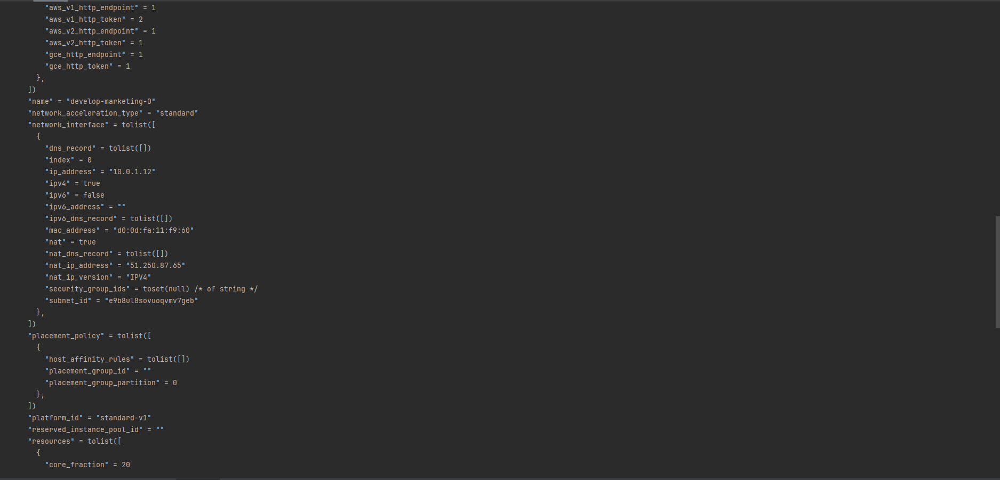
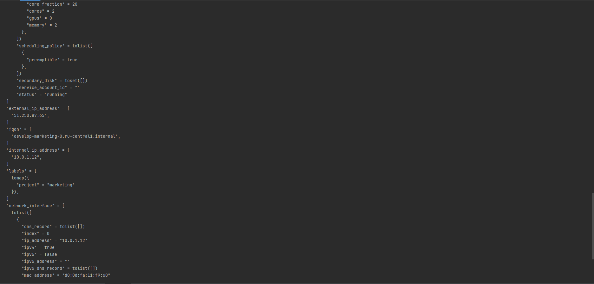
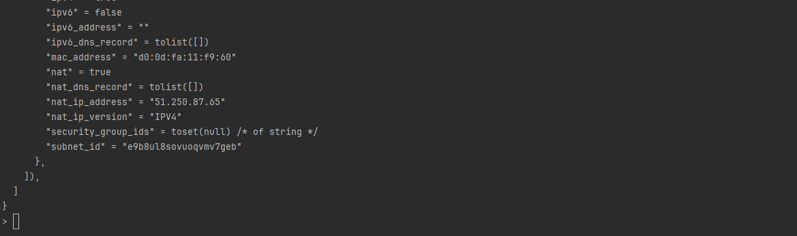

---

# Задание 2
Код: [lesson4/task2](lesson4/task2)

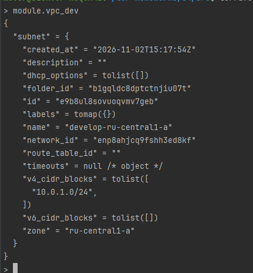

---

# Задание 3

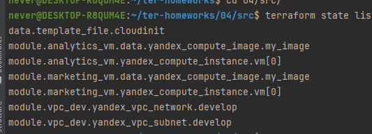

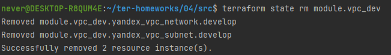
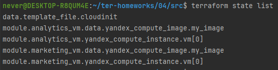
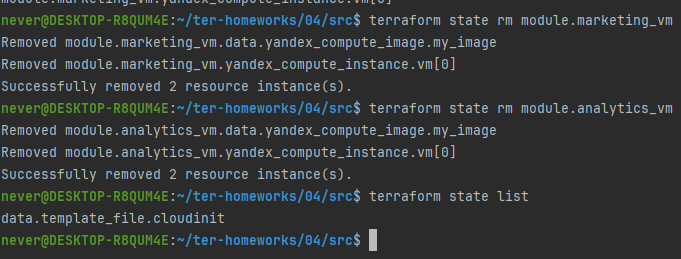
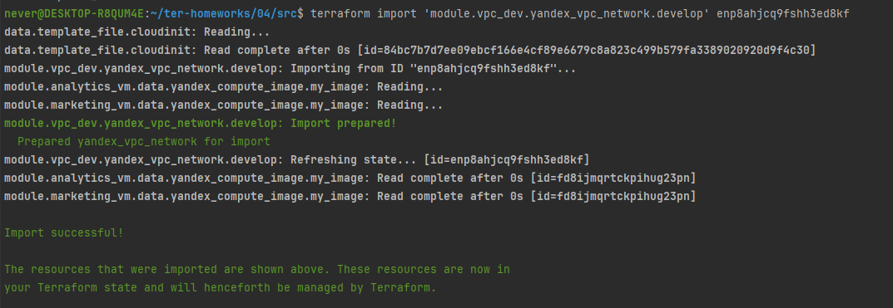
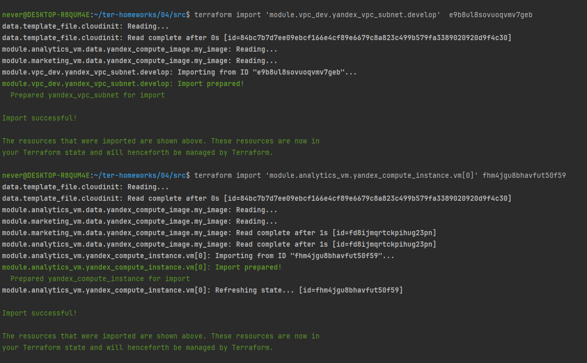

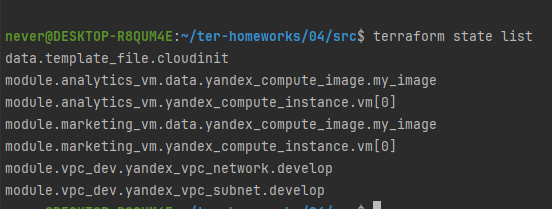

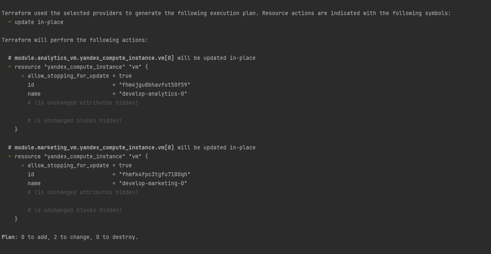

* Значимых изменений нет, то что показано в terraform plan то восстановление параметра allow_stopping_for_update в state (он не храниться в облаке)*