# Домашнее задание "Использование Terraform в команде"

---

# Задание 1
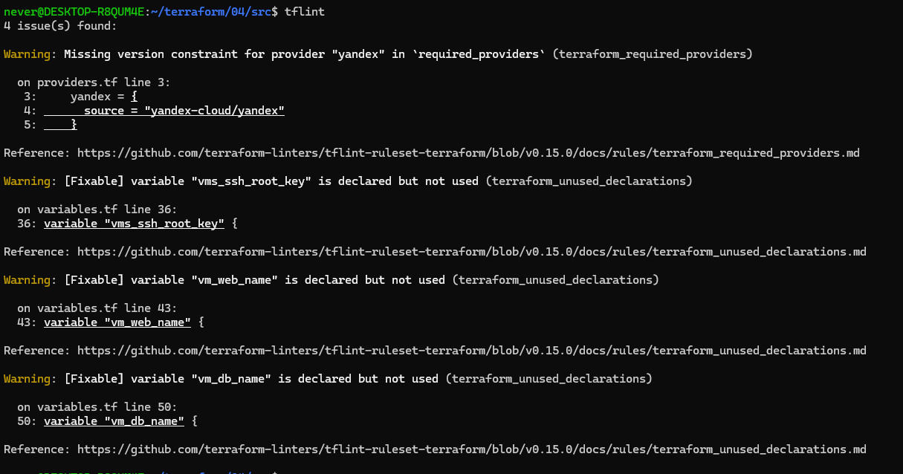
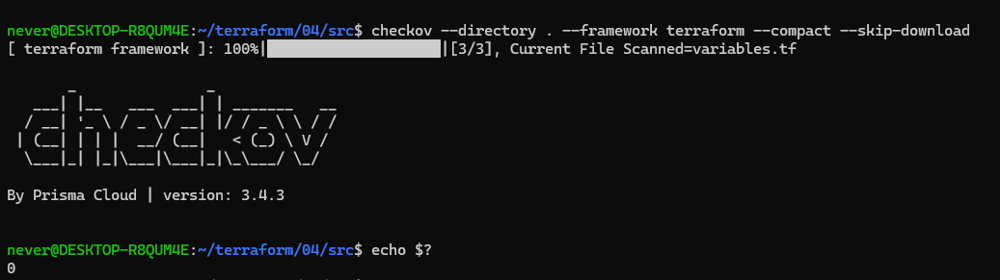
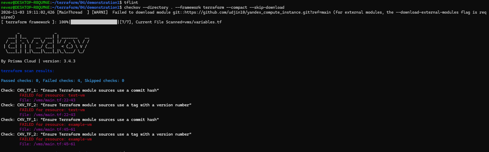

| Инструмент | Тип замечания                                                                        |
|---|--------------------------------------------------------------------------------------|
| TFLint | `terraform_required_providers` — отсутствуют ограничения версий провайдеров          |
| TFLint | `terraform_unused_declarations` — объявлены неиспользуемые переменные                | 
| TFLint | `terraform_module_pinned_source` — внешний модуль привязан к изменяемой ветке `main` | 
| Checkov | `CKV_TF_1` — источник модуля указывает не на хэш коммита                             | 
| Checkov | `CKV_TF_2` — источник модуля не использует тег с номером версии                      |


---
# Задание 2
**Код: [lesson5/task2](lesson5/task2)**

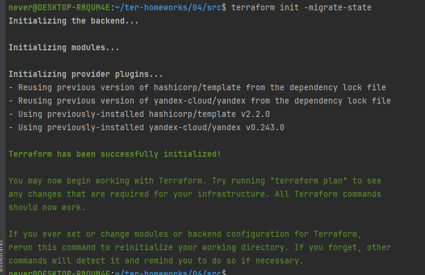
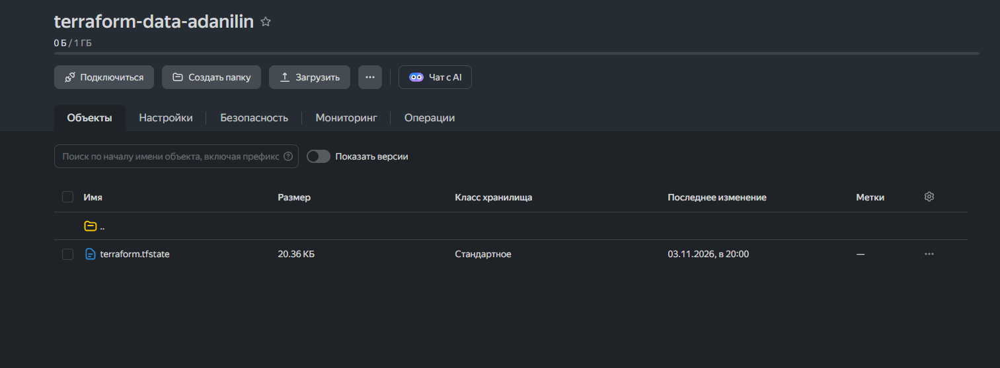
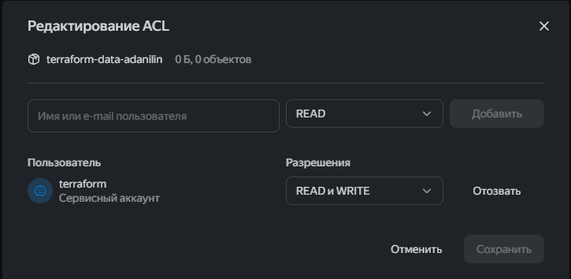

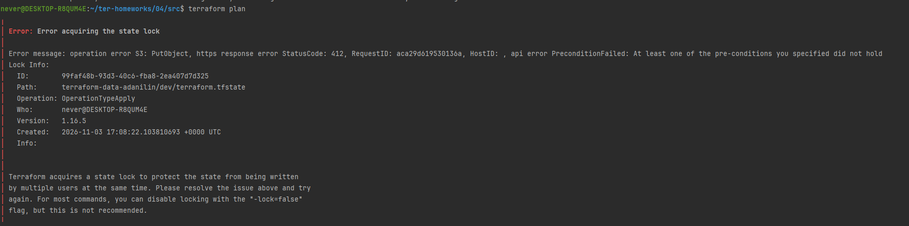
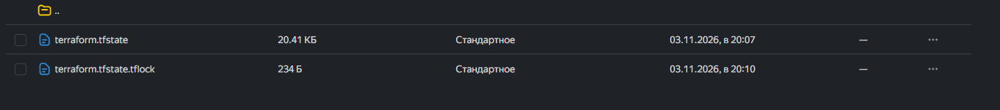

**Сделал через terraform apply и terraform plan, так как открытие консоли больше не блочит state файл**

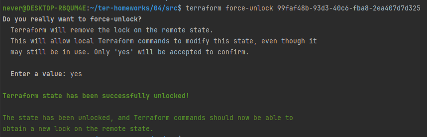

---

# Задание 4 

```commandline
variable "ip_address" {
  type = string
  default = "192.168.0.1"
  description = "ip-адрес"
  validation {
    condition = can(regex("^((25[0-5]|2[0-4][0-9]|[01]?[0-9][0-9]?)\\.){3}(25[0-5]|2[0-4][0-9]|[01]?[0-9][0-9]?)$",
      var.ip_address))
    error_message = "Invalid ip"
  }
}

variable "list_of_ip_addresses" {
  type        = list(string)
  description = "список ip-адресов"
  default = ["192.168.0.1", "1.1.1.1", "127.0.0.1"]
  validation {
    condition     = alltrue([
      for ip in var.list_of_ip_addresses : can(regex("^((25[0-5]|2[0-4][0-9]|[01]?[0-9][0-9]?)\\.){3}(25[0-5]|2[0-4][0-9]|[01]?[0-9][0-9]?)$", ip))
    ])
    error_message = "Список содержит некорректные IP-адреса"
  }
}
```


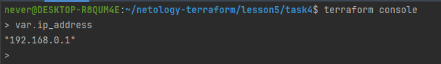
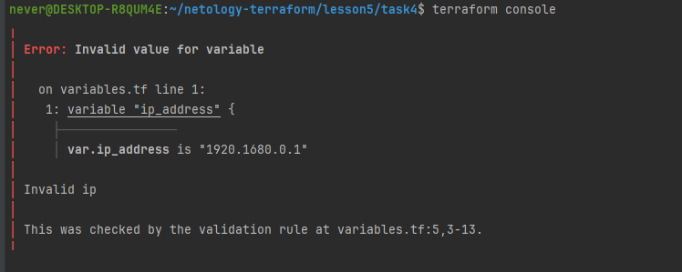
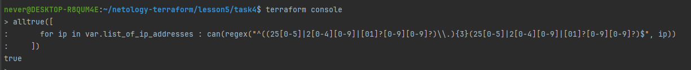
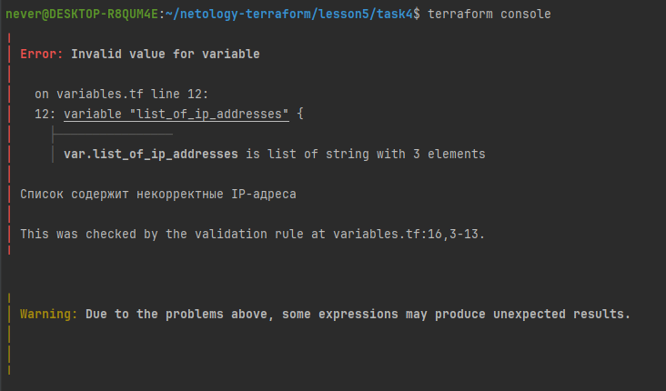